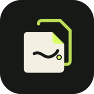

# ✨ Evexia

  

### 📚 A calmer way to plan, study, and keep life together.

Evexia brings your classes, tasks, notes, flashcards, files, and study tools into one place. Made for students, but just as handy for anyone juggling a busy week.

## 🌟 What you can do

- 🏠 **See your day at a glance** — check classes, upcoming tasks, and recent files.
- 📅 **Plan your week** — add a repeating timetable, locations, and colour-coded subjects.
- ✅ **Stay on top of tasks** — set due dates, priorities, repeat rules, and optional reminders.
- 📝 **Make notes and flashcards** — keep study material together by subject.
- 📂 **Keep files organised** — import documents, save links, and find recent or bookmarked items in your Library.
- 🔎 **Scan and work with PDFs** — scan pages, create or combine PDFs, convert pages to images, and print.
- 🤖 **Ask Evexia AI** — get help with questions or summaries of your notes and documents.
- 🎨 **Make it yours** — choose a theme and accent colour, adjust motion, or add the optional home-screen widgets.

## 🚀 Getting started

Evexia is for Android 8.0 (or newer). Add your subjects and timetable, then create tasks, notes, or flashcards as you go. You can use the main planning and study features without creating an Evexia account.

Evexia AI is optional and needs an internet connection and a Puter account. You can open it from the Home screen.

## 🔐 Your privacy, in plain language

- Your subjects, timetable, tasks, and study content are stored on your device.
- Evexia has no ads or analytics and does not require an Evexia account.
- AI is an online service: your prompts, conversation context, and text extracted from documents you submit are sent to Puter and the selected AI provider. Chat history is kept locally. Avoid sending anything you want to keep private.
- Evexia asks for notification permission only for task reminders. Widgets are optional.
- Android device backup settings may include the app's local data.

## 🖨️ Printing and widgets

Print a document from Home, the Library, or PDF Studio. Android's print screen can send it to a printer or save it as a PDF. You can also turn on black-and-white printing in Settings.

To add **Today's Schedule** or **Upcoming Tasks**, open your Android launcher's widget picker and choose Evexia.

## 📥 Get Evexia

This repository does not bundle install files. If a downloadable build is published, it will be available on [GitHub Releases](https://github.com/Jackson4Rocks/Evexia/releases).

## 💛 Made by

- **Leon Sony** — developer and designer · [Jackson4Rocks](https://github.com/Jackson4Rocks)
- **Ambhavaram Jeevan Kumar Reddy** — ideas and design · [JeevanDoom](https://github.com/JeevanDoom)

## 🤝 Thanks

- **Puter** — for powering Evexia AI through [Puter.js](https://puter.com/).
- The Instrument Sans and Instrument Serif teams — fonts included under the SIL Open Font License.
